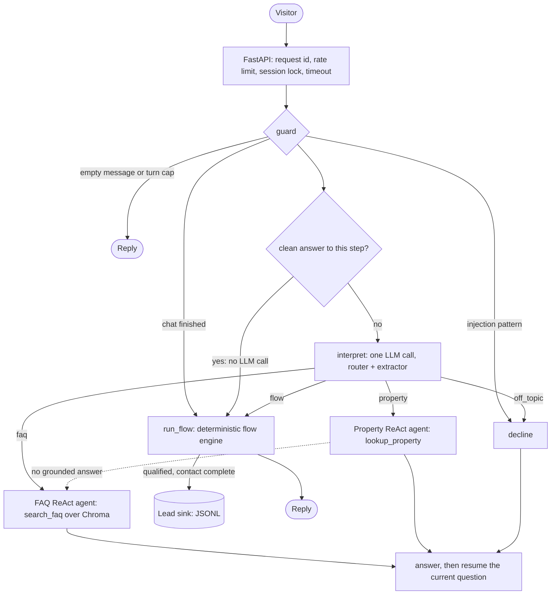

# Lead Qualification Chatbot

An AI-agent chatbot for a fictional UK estate agency. It talks to
website visitors (new-build buyers, resale buyers, buyers with a specific property, sellers),
qualifies them against the agency's data, and hands qualified leads to the sales team.

It follows the provided flowchart exactly (lanes A-E, closing messages M1/M2/M3) while still
handling free typing, side questions and changes of mind. It uses the deterministic buyer/seller
flow, grounded FAQ and property answers for side questions, and validates contact details before
a qualified hand-off.

| | |
|---|---|
| **Chat model (developed and tested with)** | Groq `openai/gpt-oss-120b` |
| **Embeddings** | Ollama / `qwen3-embedding:0.6b` |
| **Latest live evaluation** | 37/37 scenarios (100%), 19 November 2026 |

OpenAI, Gemini, OpenRouter, Mistral, Cerebras and Ollama are supported by the provider factory
(`LLM_PROVIDER`), but only the setup in the table above was verified end to end.

## Run locally

Copy `.env.example` to `.env`, set the provider and model values, then install and start the
terminal chat:

```bash
uv sync --all-groups
uv run lead-qualification-chatbot        # or: uv run python -m lead_qualification_chatbot.cli
```

All configuration comes from environment variables. Pick one setup:

```bash
# A. Groq (chat) + local Ollama (embeddings)
LLM_PROVIDER=groq
LLM_MODEL=openai/gpt-oss-120b
LLM_API_KEY=<groq key>
EMBEDDING_PROVIDER=ollama
EMBEDDING_MODEL=nomic-embed-text

# B. OpenAI for both (embeddings default to text-embedding-3-small)
LLM_PROVIDER=openai
LLM_MODEL=<model>
LLM_API_KEY=<key>

# C. Gemini for both
LLM_PROVIDER=gemini
LLM_MODEL=<model>
LLM_API_KEY=<key>
EMBEDDING_MODEL=<gemini embedding model>
```

Hosted providers require `LLM_API_KEY`. The embedding provider must also be configured when the
LLM provider has no embedding implementation (for example Groq). Other settings
(`LLM_BASE_URL`, `OFFICE_PHONE`, `DATA_DIR`, `CHROMA_DIR`, `LEADS_FILE`, `FAQ_TOP_K`,
`FAQ_MAX_DISTANCE`, `MAX_TURNS`, `MAX_OFF_TOPIC`, `RATE_LIMIT_PER_MINUTE`, `REQUEST_TIMEOUT_S`,
`LOG_LEVEL`, `LOG_JSON`, `LANGSMITH_*`) are listed in `.env.example`.

For Ollama, make sure the chat and embedding models are available locally. Use a model with tool
calling that is large enough for routing (roughly 7B and up); very small models misroute short
answers.

## HTTP API

Run the service:

```bash
uv run uvicorn lead_qualification_chatbot.api.main:app --host 0.0.0.0 --port 8000
```

| Route | Purpose |
|---|---|
| `GET /health` | Liveness |
| `GET /ready` | Readiness (the orchestrator is built) |
| `POST /sessions` | Start a conversation: returns a `session_id` and the greeting |
| `POST /chat` | Send one turn |

`API_KEY` is required when `APP_ENV=prod` (the service refuses to start without it). When it is
set, send `X-API-Key` on `/sessions` and `/chat`; `/health` and `/ready` stay open.

```json
{"session_id":"visitor-123","message":"I want to sell my home"}
```

The response contains the bot messages and flow state (`step`, `qualified`, `done`, `closing`,
`degraded`). Keep the same `session_id` for every turn in one conversation. Every response carries
an `X-Request-ID` header; requests are rate limited per client IP (`429` with `Retry-After`) and
bounded by a timeout (`504`).

The default in-memory checkpoint storage, session locks and rate limiter are intended for a
**single process**; configure a durable checkpointer, a distributed lock and a shared limiter
before scaling horizontally.

## Container

```bash
docker build -t lead-qualification-chatbot .
docker run --env-file .env -e API_KEY=<secret> -p 8000:8000 \
  -v leads:/app/leads -v chroma:/app/.chroma lead-qualification-chatbot
```

The image runs as a non-root user, includes the supplied CSV data and pins the `uv` version.
`APP_ENV=prod` is the image default, so `API_KEY` must be provided. Mount `/app/leads` (qualified
leads) and `/app/.chroma` (FAQ index) as volumes. Do not copy `.env` into an image or commit it.
When Ollama runs on the Docker host, set `LLM_BASE_URL` and `EMBEDDING_BASE_URL` to
`http://host.docker.internal:11434` and add `--add-host=host.docker.internal:host-gateway`.

## Architecture



| Layer | Responsibility |
|---|---|
| `flow/` | The flowchart as a pure state machine: steps, branches, M1/M2/M3, lane C, lane E. No LLM, no I/O. Qualification rules live in `flow/rules.py`. |
| `data/` | Pydantic-validated CSV loading (fail fast with line numbers), exact and fuzzy property lookup, seller coverage set. |
| `graph/` | LangGraph orchestrator: guard, skip-LLM shortcuts, routing, side answers, resume, lead hand-off. |
| `agents/`, `tools/`, `rag/` | LLM interpreter, two ReAct side agents, grounded tools, Chroma FAQ index. |
| `llm/` | Provider and embeddings factories, tenacity retries (honours `Retry-After`), PII redaction. |
| `leads/` | `LeadSink` protocol and the JSONL sink. |
| `api/`, `cli.py` | FastAPI service and terminal client. |
| `evals/` | Data-driven scripted conversations, pass rate, latency, transcripts, LangSmith dataset. |

## Key design decisions and trade-offs

1. **Deterministic spine, LLM at the edges.** Qualification is plain code, so the model can never
   decide a lead is qualified. The LLM extracts facts and routes side questions; every flow message
   is fixed text from the flowchart. *Trade-off:* less conversational flair, full testability.
2. **Orchestrator routes, ReAct agents answer.** The orchestrator decides what each turn is. Two
   ReAct agents (FAQ and property) answer side questions, then the flow resumes at the exact step
   via `engine.prompt(state)`.
3. **The LLM is skipped when the answer is clean** (budget, postcode, phone, email, short yes/no,
   names, buy/sell words, property names) and the text is not a question. This lowers cost and
   latency, removes LLM risk on input steps, and keeps the flow working when the provider is down.
4. **A weak model cannot hijack the flow.** Side-question routes need a question signal in the
   text, and extracted fields never replace deterministic validation.
5. **Retrieval fits each data source.**
   - *FAQ:* vector RAG (Chroma). Visitors paraphrase, so their question is matched semantically
     against FAQ questions. The index is persisted and keyed by a hash of the questions and the
     embedding model, so edits to answers need no re-index.
   - *Properties:* exact name, address or id, then token containment, then fuzzy matching
     (rapidfuzz). Names are identifiers; embeddings would blur "Apartment 3" and "Apartment 13".
   - *Postcodes:* normalised exact match in a set or dict. Nothing fuzzy may decide qualification.
6. **Grounding guard.** A side-agent answer is discarded unless a tool result backed it. No match,
   a provider error, or an answer without a tool call all return the same fixed fallback
   ("I don't have that information, please call the office"). The model never invents facts.
7. **Checkpointed state is plain JSON** (LangGraph `MemorySaver` in development), so it moves
   unchanged to a Postgres or Redis saver.
8. **Privacy by construction.** Phone numbers and emails are redacted before any text reaches an
   LLM and scrubbed from LangSmith traces. Contact details are asked only after qualification.
9. **Lead hand-off behind an interface.** Qualified leads go through `LeadSink`; the shipped
   implementation appends to an owner-only JSONL file. A CRM or queue is a new class, not a
   rewrite.

## Assumptions

- Matches are ordered by price ascending, at most five. "Within budget" means `price <= budget`.
- "Listed at this postcode" (A4, B3) counts any status. "Available" (A5, B4) filters on
  `available`; `under_offer` counts as not available.
- The resale budget (also asked in lane C5 for a gone resale home) is recorded, never used as a
  filter.
- After "anything else? yes", the journey resets but name, phone and email are kept and not asked
  again. A second qualified journey goes straight to the 24-hour confirmation and creates a second
  lead.
- The first visitor message may carry intent, name or category; those questions are then skipped.
- Lane C (a specific property) is built. A bare property name is never sent to the LLM router.
- The office number is configurable (`OFFICE_PHONE`, default `020 7946 0100`).

## Known limitations

- A mixed message ("I'm Sam, what are your hours?") gets the side answer and the flow re-asks the
  question; the volunteered fact is not applied.
- Changing intent or category mid-journey needs the LLM extractor; regex only covers the first
  buy-or-sell question.
- When the LLM provider is unavailable or rate limited (free tiers are), retries honour
  `Retry-After`, and after the last attempt side questions receive the fixed fallback while the
  flow continues on deterministic parsing.
- Sessions, locks and rate limits are in memory: one process only.
- Data is loaded at startup, so listing availability changes need a restart.
- Answer quality for FAQ and property questions depends on the model. `FAQ_MAX_DISTANCE` depends
  on the embedding model and should be recalibrated when it changes.

## Testing and evaluation

```bash
uv run ruff check .
uv run mypy src
uv run pytest -q
uv build
```

GitHub Actions runs these checks, and builds the Docker image, on pushes and pull requests. The
208 tests cover validation, qualification rules, the flow engine, retrieval, retries, privacy,
the orchestrator, the API and the evaluation scenarios, all with fakes and no API keys.

### Validation results (19 November 2026)

| Check | Result |
|---|---|
| `uv run ruff check .` | Passed |
| `uv run ruff format --check .` | Passed (100 files formatted) |
| `uv run mypy src` | Passed (51 source files) |
| `uv run pytest -q` | Passed (208 tests) |
| `uv build` | Passed (source distribution and wheel) |
| `uv run python -m lead_qualification_chatbot.evals.cli --mode fake` | Passed (29/29 scenarios, 100%; p50 4 ms, p95 6 ms) |
| `uv run python -m lead_qualification_chatbot.evals.cli --mode live --throttle 20` | Passed (37/37 scenarios, 100%; Groq `openai/gpt-oss-120b`; p50 10 ms, p95 673 ms) |

**Scripted-conversation evaluation** (`evals/`): scenarios generated from the CSVs for lanes A-E,
input handling and safety, plus (live only) FAQ, property, off-topic and change-of-mind turns.
Expected outcomes come from a brute-force oracle independent of the rules code.

```bash
# No LLM: flow, rules, input handling, safety guard, lane C. Also runs as a pytest; must be 100%.
uv run python -m lead_qualification_chatbot.evals.cli --mode fake

# Real LLM, all scenarios; reports pass rate by lane and p50/p95 turn latency.
# --throttle pauses after each LLM scenario (useful on rate-limited free tiers).
uv run python -m lead_qualification_chatbot.evals.cli --mode live --throttle 20 \
  --out reports/live.json --transcripts transcripts
```

Live runs write leads to an in-memory sink, never to the real leads file.

**Transcripts.** `transcripts/` holds sample conversations for lanes A, B, C and D, including FAQ
questions asked mid-flow. `src/lead_qualification_chatbot/resources/transcripts.jsonl` is the
versioned regression corpus; it covers qualification and closing outcomes and is tested locally.
To upload it and run the deterministic outcome evaluator in LangSmith:

```bash
LANGSMITH_API_KEY=... LANGSMITH_TRACING=true uv run lead-qualification-evals
```

The command creates or reuses the `lead-qualification` dataset, uploads the transcripts, and
records an experiment named `lead-qualification-regression-*`. Contact data is redacted from
LangSmith tracing by the application scrubber; keep real visitor transcripts out of the committed
corpus. `python -m lead_qualification_chatbot.evals.cli --langsmith` also uploads the generated
scenarios as a dataset and runs an experiment. Tracing is opt-in (`LANGSMITH_TRACING`).

## Production hardening

| Risk | Handled | With more time |
|---|---|---|
| Prompt injection, rule override | Guard patterns before the LLM; visitor text tagged as data with angle brackets stripped; schema-only LLM output; business rules in code, not prompts; repeated off-topic turns end the chat | Classifier-based guard; red-team evaluation set |
| Invented company or property facts | Answers only from tool results; no result or no tool call returns a fixed fallback; temperature 0 | Answer-versus-source verifier |
| Personal data leaking to the LLM provider, traces or logs | Phone and email redacted before the LLM; trace scrubbing; contact details never logged; lead file mode 0600 | Encryption at rest; retention policy; consent wording |
| Provider outage or rate limits | Retries for transient errors only, honouring `Retry-After`; deterministic flow works without the LLM | Circuit breaker; provider fallback chain |
| Runaway cost or latency | Skip-LLM shortcuts; one LLM call per turn; ReAct recursion limit; request timeout; turn cap | Per-session token and cost budget |
| Abuse and floods | Per-IP rate limit; message length cap; API key (required in prod) | Edge WAF; per-session limits |
| Concurrent requests in one session | Per-session lock | Distributed lock |
| Lost leads | Append-only sink; startup check that the file is writable; failures logged without contact data | Outbox queue or CRM webhook with retries and idempotency keys |
| Stale availability | Reload on restart | Live listings API or scheduled refresh |
| Session memory growth | None (in-memory checkpointer) | Postgres or Redis saver with a TTL |
| Observability | Structured JSON logs, request ids, per-turn latency; opt-in masked LangSmith tracing | Metrics, alerts, dashboards |
| Supply chain and secrets | Locked dependencies, pinned `uv` image, non-root container, no secrets in the image | Pin CI actions to commit SHAs; image scanning |
